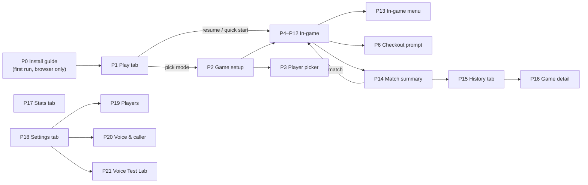

# Product: decisions, screen map and wireframes

**Status:** approved 2026-11-11, with visual direction **Chalk** ([../design/chalk.md](../design/chalk.md)). Voice behaviour is specified in [../specs/voice.md](../specs/voice.md).

**App name:** `[APP NAME]` (placeholder; the code uses a single `APP_NAME` constant).

---

## 1. Principles

1. **Voice first, never blind.** Spoken darts appear as chips with a running total before anything commits. A short, visible grace countdown lets the player cancel or fix a dart.
2. **One simple flow:** Play → pick a mode → one setup screen split into *Players* and *Rules* → game → summary with **Rematch**. Unfinished games are offered for resume or discard. "Who throws first" offers *As listed*, *Random* or *Bull-off*.
3. **Avoid common scorer frustrations:**
   - a dense keypad with unevenly sized keys
   - a "darts used" checkout prompt after every finish, which also skews stats
   - busts that aren't recorded per dart
   - undo that doesn't fully revert
   - checkout % averaged per match instead of per attempt
   - a cramped Cricket board with rows cut off
4. **Readable from the oche.** The remaining score and the current turn are the largest things on screen, and doubles vs trebles never rely on colour alone.

---

## 2. Decisions

| Area | Decision | Why |
|---|---|---|
| Navigation | Bottom tab bar with **Play · History · Stats · Settings**. It hides during a game. Players are managed in setup and in Settings › Players. | 4 tabs fit comfortably, and Play is always one tap away. |
| Accounts | None. Saved local player profiles plus quick guests, all in IndexedDB. Settings › Data has a backup export/import. | Zero cost, offline, and no cloud means backups matter. |
| Default X01 input | **Per-dart keypad** (S/D/T + 1–20 + 25/Bull/Miss). The total keypad is one tap away and the choice is remembered. | Voice produces per-dart data, and per-dart gives exact bust, checkout % and live checkout hints. |
| Checkout prompt | Only with total-keypad input, and only when it can't be derived: darts used (1/2/3) and darts at double. | Asking after every finish is slow and makes stats wrong. |
| Checkout % | Checkouts ÷ darts at double, aggregated per attempt (not averaged per match). | It's the standard definition. |
| Mic button | Large round key (≥ 58 pt), **bottom-centre** in the keypad's last row. Same place in every mode. In **hands-free** mode there is no button to press: the mic stays open all game and the key becomes a status light (tap to pause). | In the thumb zone for either hand, and impossible to miss. |
| Mic modes | **Push-to-talk** (tap, speak, auto-stop on silence) and **Hands-free** (mic open for the whole game; each pause finalises a phrase). Both work with Vosk and with Web Speech. | Hands-free suits players who call darts from the oche. |
| Hands-free filter | Only phrases that fully parse into valid darts or commands are acted on. Everything else is ignored silently and logged in the Voice Test Lab. Optional **wake word** ("score"), off by default, for noisy rooms. | Background talk must never score. |
| Voice commit | Chips + total appear immediately, then auto-commit after **1.5 s** (setting), with a visible ring countdown. **Low-confidence parses wait for a confirmation instead of auto-committing.** Tapping a chip opens the keypad on that dart. | Fast when recognition is right, safe when it isn't. |
| Turn assembly | Darts gather across phrases. A turn completes at **3 darts**, on "next"/"done", or **immediately on a checkout or bust** (or whatever ends the turn in that mode). A **Done ▸** key appears after 1–2 darts (remaining darts count as misses). | Works for players who call each dart as they throw and for players who call all three at the end. |
| Players | 1–8. **2 players:** side-by-side cards. **3–8:** compact list with the active row enlarged. | Keeps scores large. |
| Who starts | Setup field: *As listed* / *Random* / *Bull-off* (pick the winner). The starter rotates each leg. | Covers the usual options in one field. |
| Theme | **Chalk** (dark) + **Whiteboard** (light). The default follows the system, with a one-tap **Bright room** switch in game. | Pubs are dark and kitchens are bright. The readability check found dark-on-light reads better in bright rooms. |
| Views | **Hand view** (keypad visible) and **Distance view** (keypad collapsed, numbers 2× larger). Distance view is automatic in hands-free mode. | Remaining score 17′ at 2.4 m in Hand view, 32′ in Distance view. |
| Screen awake | Wake Lock during games (feature-detected, silent fallback), re-requested when the app returns to the foreground. | The phone sits on a shelf between turns. |
| Killer | Not built now. The engine interface leaves room for it, and for a bot and online play. | Not in the mode list. |

---

## 3. Rule decisions per mode

Where common practice differs from the brief, this is what gets built. The brief's rule stays the default unless noted.

| Mode | Brief | Decision |
|---|---|---|
| X01 | As specified | As specified. Add "win by two legs" as an optional match setting. |
| Cricket | 15–20 + bull, optional cut-throat | As specified. *Tactics* (10–20) is a later setting. |
| Around the Clock | Fewest darts wins | Multiplayer: **first to finish wins** (turn order settles ties), with darts as the stat. Add an **order** setting (1→20, 20→1, random) and **bull type** (outer / inner / either). |
| Shanghai | 7 or 20 rounds, instant win, else highest | As specified. "Require number" and "require treble" penalties come later. |
| Bob's 27 | Over below 0 (setting: at or below 0) | One setting, **Game over:** *below 0* (default) / *at or below 0* / *never (play to the bull)*. That covers the usual easy/hard variants. |
| Halve-It | Configurable sequence | As specified, with the default sequence from the brief. Colour and exact-score rounds come later. |
| 121 Checkout | +1 on success; previous target or reset to 121 on failure | As specified, plus **dart limit** (3–15, default 9). |
| Singles Training | Count hits | Count hits **and** score points (S=1, D=2, T=3). Show hit % and points. Add an order setting. |
| Doubles Training | Hit each double, count darts | As specified, plus an **order** setting. |
| Score Training | N visits, default 10 | As specified, plus **Unlimited**. |
| Random Checkout | Brackets, up on success, down on failure | Brackets: 2–40, 41–60, 61–80, 81–100, 101–130, 131–170. As specified, with a dart limit (default 9). |

---

## 4. Screen map



**Tap counts (launch → first dart)**
- Rematch / resume: **1** (the card on Play)
- New game, same players: **2** (mode → Start)
- New game with a new guest: **4** (mode → Add → type name → Start)

---

## 5. Wireframes

Notation: `[ ]` button, `▶` active player, `( )` toggle, `⋯` menu. Sizes are iPhone points. Every screen respects the safe-area insets. Keys are at least 44 pt, and 52–58 pt in game.

### P0 · Install guide (first run, only when not already installed)
```
┌──────────────────────────────────────┐
│  [mark]  [APP NAME]                  │
│  Free voice darts scorer. Works      │
│  offline once installed.             │
│  ( iPhone )( Android )               │  ← auto-selected from the user agent
│  1  Tap Share  [⬆︎ icon]              │
│  2  Scroll, tap "Add to Home Screen" │
│  3  Open [APP NAME] from your Home   │
│     Screen                           │
│  [ Continue in browser ]             │
└──────────────────────────────────────┘
```
Shown only if `display-mode: standalone` / `navigator.standalone` is false and it hasn't been dismissed. It can be reopened from Settings › Install & share.

### P1 · Play (home)
```
┌──────────────────────────────────────┐
│ [APP NAME]                    Share ⬆︎│
│ ┌──────────────────────────────────┐ │
│ │ Resume · 501 · Sam 112 – Alex 237│ │  ← only if a game is unfinished
│ │ [ Resume ]          [ Discard ]  │ │
│ └──────────────────────────────────┘ │
│ ┌──────────────────────────────────┐ │
│ │ Rematch: 501 DO · Sam v Alex  ▸  │ │  ← last setup, 1 tap
│ └──────────────────────────────────┘ │
│ MATCH                                │
│  X01        301/501/701, legs & sets ▸│
│  Cricket    Close 15–20 and bull    ▸│
│ TRAINING                             │
│  Around the Clock · Shanghai ·       │
│  Bob's 27 · Halve-It · 121 Checkout ·│  ← one row each with a 1-line explainer
│  Singles · Doubles · Score ·         │
│  Random Checkout                     │
├──────────────────────────────────────┤
│  Play    History    Stats   Settings │
└──────────────────────────────────────┘
```

### P2 · Game setup (one screen per mode, same structure)
```
┌──────────────────────────────────────┐
│ ‹  X01                    How to play│  ← opens the mode's rulesText
│ PLAYERS                              │
│  ≡ 1 Sam                          ✕  │  ← drag ≡ to reorder
│  ≡ 2 Alex                         ✕  │
│  [ + Add player ]                    │
│  Who starts  ( As listed )( Random ) │
│              ( Bull-off )            │
│ RULES                                │
│  Start      ( 301 )(•501)( 701 )(…)  │
│  Out        ( Straight )(•Double)    │
│             ( Master )               │
│  In         (•Straight )( Double )   │
│  Match      ( First to )( Best of )  │
│             legs [ – 3 + ]  sets [off]│
├──────────────────────────────────────┤
│ [            START GAME            ] │  ← sticky, thumb zone
└──────────────────────────────────────┘
```
The last-used players and rules are preselected. Mode-specific rule rows come from each mode's `settings` schema. In hands-free mode, the *Start game* tap is the gesture that opens the mic.

### P3 · Player picker (bottom sheet)
```
│ Add players                     Done │
│ [ New name…               ] [ Add ]  │  ← keyboard opens on show
│ SAVED                                │
│  ☑ Sam     ☐ Alex    ☐ Jo   ☐ Kim    │
│ [ + Guest (not saved) ]              │
```

### P4 · In-game X01, 2 players, per-dart keypad (portrait)
```
┌──────────────────────────────────────┐
│ ‹       501 · First to 3 legs      ⋯ │
│          Leg 2 · Alex threw first    │
├───────────────────┬──────────────────┤
│ ▶ Sam         (1) │   Alex       (0) │  ← active card: inverted/raised
│      112          │      237         │  ← largest type on screen
│ T20 · 12 · D20    │                  │  ← checkout hint, active player only;
│ 77.8 avg·15 darts │ 44.0 avg·18 darts│    updates for darts left in turn
│ Last 100          │ Last 41          │
├───────────────────┴──────────────────┤
│ [T12] [T12] [ 8 ]  = 80     ◔ 1.2s   │  ← turn strip: 3 slots + countdown
│ "triple twelve, triple twelve, eight"│  ← transcript; "112 → 32" preview
├──────────────────────────────────────┤
│ (•Single)( Double )( Treble ) [123]  │  ← multiplier resets to Single
│ [ 1 ][ 2 ][ 3 ][ 4 ][ 5 ]            │     after each dart; [123] = total pad
│ [ 6 ][ 7 ][ 8 ][ 9 ][10 ]            │
│ [11 ][12 ][13 ][14 ][15 ]            │
│ [16 ][17 ][18 ][19 ][20 ]            │
│ [Undo][Miss]( 🎤 )[ 25 ][Bull]        │  ← mic raised, centre
└──────────────────────────────────────┘
```
- The turn strip is the **single landing place for voice and taps**. Each dart fills a slot as it's entered, whether the darts arrive in one phrase or one at a time. After the 3rd dart, "next"/"done", a checkout or a bust, the grace countdown runs and then the turn commits.
- **Checkout or bust before dart 3** ends the turn straight away. There's no waiting for more darts.
- **Bust:** the strip turns to the bust colour and shows "BUST · stays 112". The turn reverts on commit.
- **Undo:** removes the last dart in the strip. With the strip empty, it reverts the previous committed turn (state history, so it is always exact).
- **Long-press a committed turn** (in the turn log under ⋯, or the "Last" line on a card) → *Report misheard* → saved to the Voice Test Lab log.

### P4b · Total keypad (toggle via [123])
```
│ Entered: 80                 [ S D T ]│
│ [26][41][45][60][81][85][100][140] → │  ← quick scores, scrolls; editable
│ [ 1 ][ 2 ][ 3 ][  ⌫  ]               │
│ [ 4 ][ 5 ][ 6 ][  0  ]               │
│ [ 7 ][ 8 ][ 9 ][  OK ]               │
│ [Undo][No score]( 🎤 )[Bust]          │
```
Impossible totals (163, 166, 169, 172, 173, 175, 176, 178, 179, above 180) shake the field and don't submit.

### P4c · 3–8 players
```
│ ▶ Sam     112   T20·12·D20  77.8  (1)│  ← active row is twice the height,
│   Alex    237               44.0  (0)│    with the big number
│   Jo      301               51.2  (0)│
│   Kim     180               60.1  (1)│
```
The turn strip and keypad are unchanged below. At 6–8 players the inactive rows shrink to one line.

### P4d · Landscape
Scoreboard on the left (≈55%), turn strip and keypad on the right (≈45%). The keypad uses 4 columns × 5 rows plus the bottom row.

### P4e · Distance view (hands-free, or "Big numbers" in push-to-talk)
```
┌──────────────────────────────────────┐
│ 501 · Leg 2                   ☀︎   ⋯  │  ☀︎ = Bright room
│ ▶ SAM                       legs 1   │
│          1 1 2                       │  200 pt, fit to width (32′ at 2.4 m)
│  [T20] [ 12 ] [D20]                  │  checkout route, 64 pt chips
│  [T12] [T12] [ 8 ]                   │  this turn, 64 pt chips
│                 = 80     ◔           │  turn total 112 pt (18′)
│  ALEX 237     JO 301                 │  104 pt for 2–4 players
├──────────────────────────────────────┤
│ [Undo]   ● Listening…   [Keypad ▴]   │  56 pt bar; Keypad ▴ = back to Hand view
└──────────────────────────────────────┘
```
Sizes and the reasoning are in [../design/chalk.md](../design/chalk.md#two-in-game-views).

### P5 · Voice states (inside the turn strip)
| State | Strip shows | Mic key |
|---|---|---|
| Idle | empty slots, hint "Tap 🎤 and say your darts" | accent |
| Listening | live level meter, interim words in grey | pulsing ring |
| Parsed | chips + total + countdown ring | accent |
| Low confidence | chips with a dashed outline + "Tap to confirm" | accent |
| Not understood (push-to-talk) | "Didn't catch that: 'tripple tw…'" + [Retry] | accent |
| Speaking (read-back) | chips, with "🔊"; the mic is muted until 300 ms after speech ends | muted icon (no overlap) |
| Mic blocked | "Microphone is blocked. Settings › Safari › Microphone" | struck through |
| **Hands-free: listening** | "● Listening" in the bottom bar; darts gather in the strip as each phrase finalises. Phrases that don't parse are ignored with no message. | status light, tap to pause |
| **Hands-free: wake word on** | "● Say *score* first" | status light |
| **Hands-free: waiting for a confirm** | low-confidence chips + "Say *yes* or *no*" | status light |
| **Hands-free: paused by you** | "Paused · tap to listen" | grey |
| **Hands-free: mic paused by the phone** | full-width banner "**Mic paused** · tap to resume" after a call, Siri or a screen lock. When the app comes back to the foreground it reopens the mic itself and only shows the banner if that fails. | amber, struck through |

### P6 · Checkout prompt (bottom sheet, total keypad only)
```
│ Game shot! Darts used   ( 1 )( 2 )(•3) │
│ Darts at a double       ( 1 )(•2)( 3 ) │
│ [ Confirm ]                            │
```

### P7 · Leg won
A full-width banner over the scoreboard reads "Sam wins leg 2 · 15 darts · 77.8". It auto-advances after 2 s, or on tap. The set/match score updates. The caller announces it if enabled.

### P8 · In-game Cricket
```
│ ‹      Cricket · First to 2       ⋯ │
│   ▶ Sam  42      TARGET     Alex 17 │  ← points
│      ⓧ             20          /    │  ← /, X, ⓧ marks; drawn ≥ 32 pt
│      X             19          ⓧ    │
│      /             18               │
│                    17          X    │
│      ⓧ             16               │  ← all 7 rows always visible
│                    15          /    │
│                   BULL              │
│ [T20] [S19] [ • ]          ◔ 1.3s   │
│ (•S)(D)(T)  [15][16][17][18][19][20] │
│ [Undo][Miss]( 🎤 )[ 25 ][Bull]        │
```
- **3–4 players:** a target column on the left and one column per player. A closed row turns grey when everyone has closed it.
- **Cut-throat:** the points label reads "Points (low wins)".

### P9 · In-game target modes (shared shell: Around the Clock, Shanghai, Singles, Doubles, Halve-It)
```
│ ‹      Around the Clock           ⋯ │
│              TARGET                  │
│                7          next 8     │  ← huge target; Halve-It shows
│   ●●●●●●◉○○○○○○○○○○○○○○  7 / 21      │    "Any double", etc.
│ ▶ Sam   on 7   19 darts              │
│   Alex  on 5   18 darts              │
│ [ • ][ • ][ • ]                      │
│ [ Miss ][ Single ][ Double ][Treble ]│  ← hits on the current target
│ [Undo]       ( 🎤 )      [Full pad ⌄]│
```
Modes needing an arbitrary segment (Halve-It "any double", Doubles training with bull) switch to the full per-dart pad. Voice accepts bare multipliers ("double", "treble, miss, single") resolved against the target, as well as normal darts.

### P10 · In-game Bob's 27
```
│              TARGET  D7              │
│        +14 per hit · −14 if none     │
│ ▶ Sam  81      Alex  27              │
│ [ 0 hits ][ 1 ][ 2 ][ 3 ]            │  ← one tap per turn
│ [Undo]       ( 🎤 )      [Per dart ⌄]│
```
Voice: "no hits", "one hit", "two hits", "three"; per-dart phrases also work.

### P11 · In-game checkout trainers (121 Checkout, Random Checkout)
```
│  TARGET 121       darts left ●●●●●●●○○ │
│  Remaining 61     T15 · D8             │
│  Bracket 101–130 · 8 pts (Random only) │
│  … X01 per-dart pad (P4) …             │
```

### P12 · In-game Score Training
Visit `4 / 10`, a large running average, last visit and total, using the total keypad by default.

### P13 · In-game menu (⋯ sheet)
- How to play (the mode's rules)
- Input: per-dart / total
- Voice: on/off, push-to-talk / hands-free, wake word on/off, read-back on/off
- Caller on/off
- Turn log (editable via undo)
- Restart leg
- End game (with confirmation)

### P14 · Match summary
```
│        Sam wins 3 – 1                │
│        [ Rematch ]  [ New game ]     │
│              Sam      Alex           │
│  3-dart avg  77.8     52.3           │
│  First 9     91.0     60.7           │
│  Checkout %  3/7 43%  1/9 11%        │
│  High CO     112      40             │
│  100+ /140+ / 180   5/2/0  1/0/0     │
│  Darts/leg   16.3     –              │
│  ▸ Leg by leg (expand)               │
│  ▸ Average per visit (chart)         │
│  [ Share result ]   [ Home ]         │
```

### P15 · History
A list of game cards: "501 · Sam 3–1 Alex · 11 Nov 21:40". Filters are mode, player and period. Unfinished games are pinned at the top.

### P16 · Game detail
The P14 summary on top, then the full turn log per leg. Long-press a turn to get *Report misheard*.

### P17 · Stats
- Player picker, mode picker (X01 default), period.
- **X01 tiles:** 3-dart avg, first-9 avg, checkout %, highest checkout, 100+, 140+, 180.
- **Charts:** average trend over time, and checkout % trend.
- **Other modes:** that mode's headline stat (e.g. Bob's 27 best and average, Around the Clock darts).

### P18 · Settings
- **Players**
- **Voice & caller**
- **Input:** default X01 pad, quick-score buttons, grace period, haptics
- **Display:** theme, keep screen awake
- **Data:** export/import backup, clear history
- **Voice Test Lab**
- **Install & share**
- **About:** version, licences

### P19 · Players
A list of profiles (name, colour, initials) with Add, Edit and Delete. Delete asks for confirmation. History is kept but labelled "deleted player".

### P20 · Voice & caller
- **Engine:** Auto / Vosk (offline) / Web Speech. Auto picks Vosk in an installed iPhone app and Web Speech elsewhere.
- **Language:** default en-GB.
- **Mic mode:** push-to-talk / **hands-free** (mic open all game, no button). It works with both engines. The defaults per platform get decided from the iPhone results.
- **Wake word:** off (default) / on, "score". When on, only phrases that start with "score" (or follow it within 4 s) are acted on.
- **Offline model:** status, size, [Download] / [Remove].
- **Read-back** on/off. The mic is muted while the app speaks.
- **Caller:** on/off, voice, rate.
- **[Test microphone]**
- Each unsupported option shows why: "Not available in this browser".

### P21 · Voice Test Lab
```
│ Engine ( Vosk ▾ )   Lang en-GB       │
│               ( 🎤 )                 │
│ Heard   "triple twelve triple twelve │
│          eight"                      │
│ Alternatives                         │
│   1 triple twelve triple twelve eight│
│     0.91                             │
│   2 triple twelve triple twelve ate  │
│     0.74                             │
│ Parsed  T12 · T12 · S8 = 80   312 ms │
│ [ ✓ Correct ]  [ ✗ Wrong → enter ]   │  ← ✗ opens the per-dart pad
│ Accuracy  Vosk 92% (48) · Web 88%    │
│ (31)                                 │
│ [ Log ▸ ]   [ Ignored ▸ ]  [ Export ]│  ← Ignored = hands-free phrases
└──────────────────────────────────────┘     that didn't parse
```

### P22 · Global
- **Update toast:** "New version available – tap to refresh"
- Offline indicator (only if a model download is needed)
- Mic-permission and error banners use the P5 wording

---

## 6. Visual direction

**Chalk**, chosen from three original directions. The full spec is in [../design/chalk.md](../design/chalk.md), with the readability check in [../design/chalk-readability.md](../design/chalk-readability.md).

## 7. Still open

- An app name (optional).
